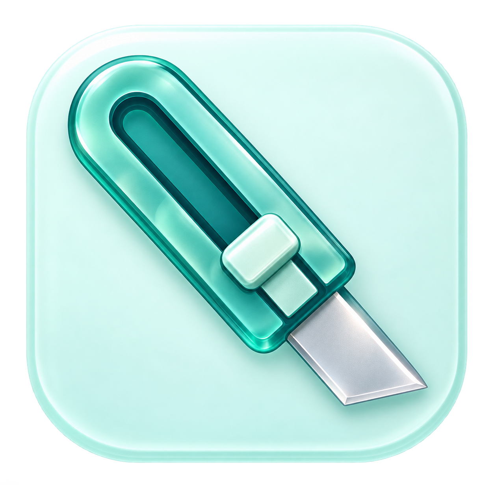
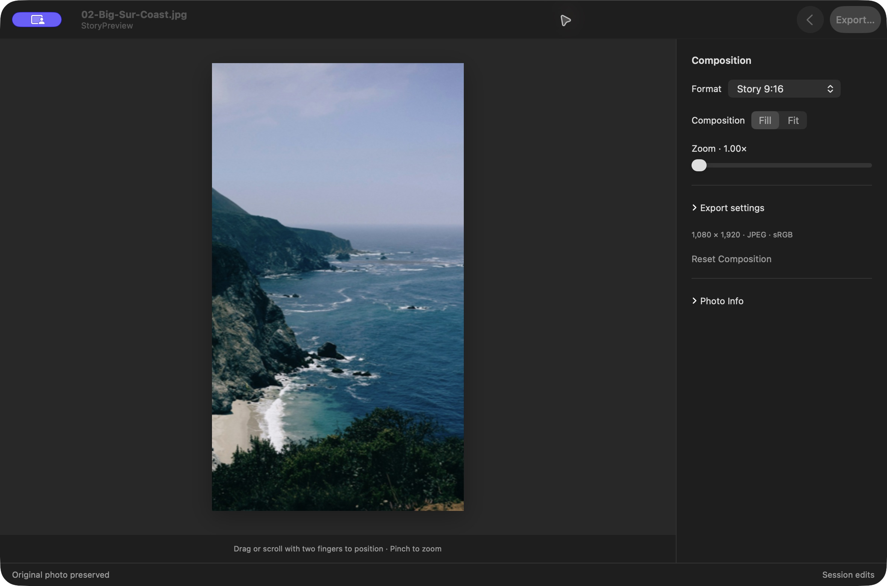
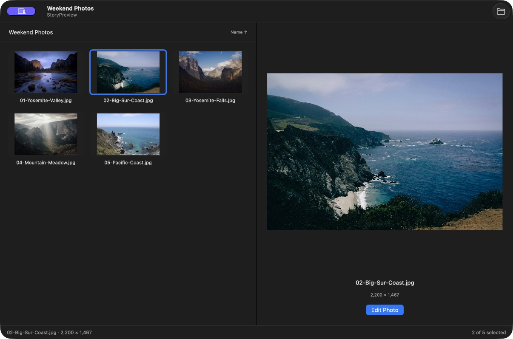
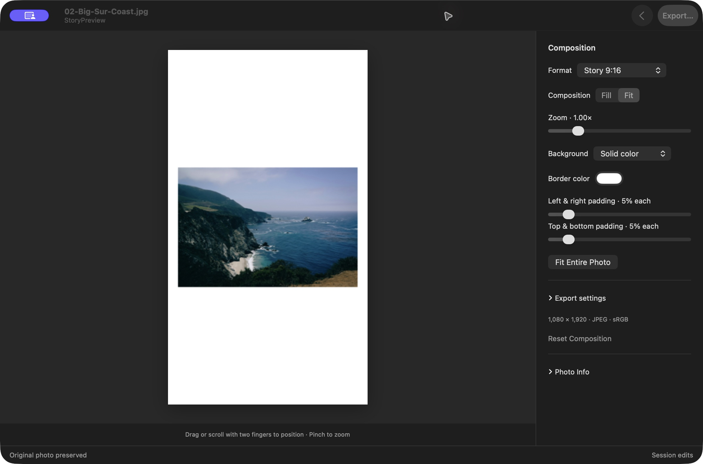
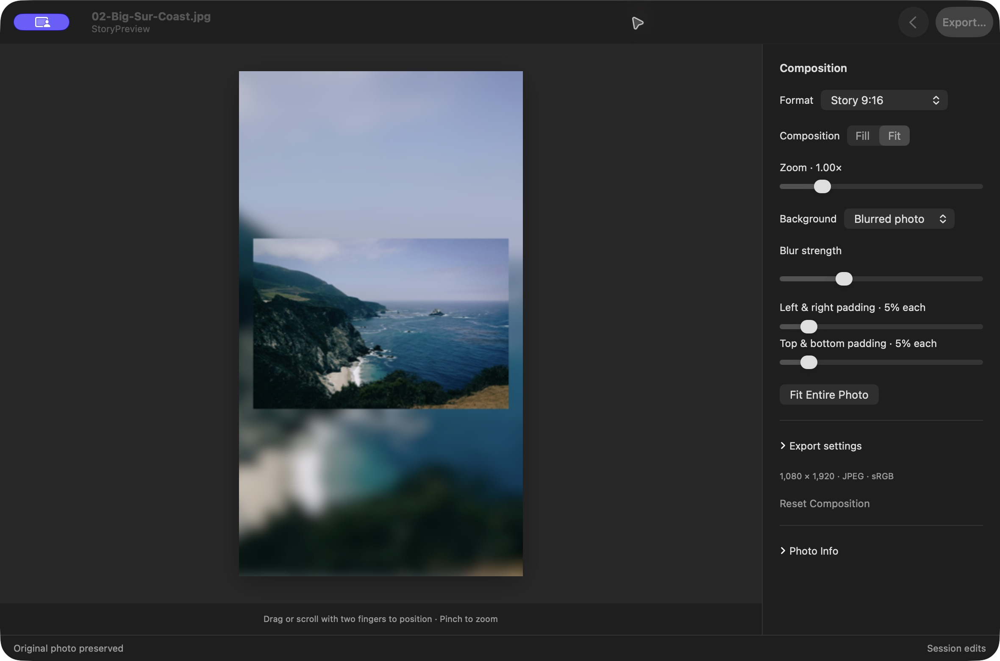

<p align="center">
  
</p>

<h1 align="center">StoryPreview</h1>

<p align="center">Find the right crop. Keep the parts you love.</p>
<p align="center">Native macOS · Local photos · No accounts or uploads</p>



See how your photos will look as an Instagram Story, portrait post, or square before you share them. Move and zoom to find your framing—or keep the entire photo with a solid or blurred border.

### Made for your photo folder

- **Browse, then edit.** Open a folder, move through thumbnails with the arrow keys, and preview your selection at a larger size. Resize the panes to give your photos more room.
- **Find your framing.** Choose Story 9:16, portrait 4:5 or 3:4, square, landscape, original, or a custom ratio.
- **Use your trackpad.** Pan with two fingers, pinch to zoom, or drag the photo into place.
- **Keep the whole shot.** Fit a landscape photo into a vertical Story with a color or blurred-photo background and adjustable borders.
- **See your camera settings.** Photo Info shows available EXIF details, including camera, lens, shutter speed, aperture, ISO, and date taken.
- **Export a copy.** Save a JPEG or PNG at your chosen size. Your original stays untouched.

### Browse without losing your place



Double-click a photo or press Return to edit. Press Escape to return to the same gallery position, selection, and pane sizes.

### A vertical Story doesn't have to mean a tighter crop

Choose **Fit** to keep the full photo, then pick the background that suits it.

| Solid borders | Blurred photo background |
| --- | --- |
| [](docs/screenshots/borders-solid.jpg) | [](docs/screenshots/borders-blurred.jpg) |

Adjust the top/bottom and left/right spacing independently. Switch back to **Fill** whenever you want the photo to cover the frame.

## Get started

Requires **macOS 14 or later** and a **Swift 6 toolchain** (included with Xcode).

```sh
git clone https://github.com/tsun1650/ig-tools.git
cd ig-tools
./scripts/build-app.sh
open build/StoryPreview.app
```

For everyday use, drag the built **StoryPreview.app** into **Applications**.

1. **Open a folder** of JPEG, PNG, HEIC, or TIFF photos.
2. **Choose a photo and edit** its crop, position, zoom, and borders.
3. **Export** a new image. The default Story size is 1080 × 1920.

| Shortcut | Action |
| --- | --- |
| ⌘O | Open a folder while browsing |
| Arrow keys | Move through thumbnails |
| Return | Edit the selected photo |
| Escape | Return to the gallery |
| ⇧⌘E | Export from the editor |

Edits are remembered for the current session; export your work before quitting. The app browses one folder at a time and supports still images; RAW, animated images, and subfolder browsing are not included. Exports use sRGB and omit source metadata.

---

Built with SwiftUI and AppKit. [Development notes](docs/DEVELOPMENT.md) · [Screenshot photo credits](docs/screenshots/CREDITS.md)
